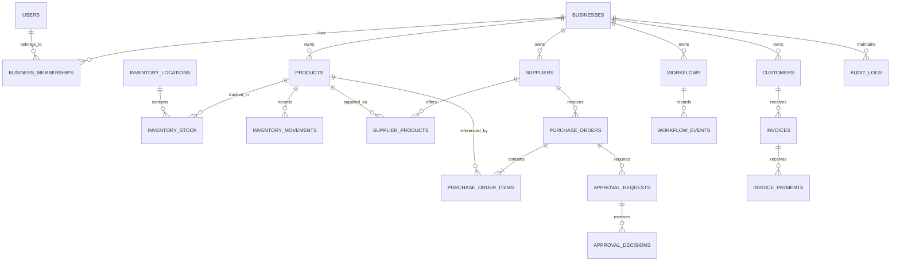

# Beelzebub — Database Design

**Project:** Beelzebub  
**Document:** Database Design  
**Version:** 1.0  
**Status:** Proposed Schema  
**Database:** PostgreSQL  
**ORM:** SQLAlchemy  
**Migrations:** Alembic  
**Related documents:** PRODUCT_REQUIREMENTS.md, ARCHITECTURE.md

---

# 1. Database Design Objectives

The Beelzebub database must provide a reliable foundation for managing business operations.

The database must:

1. Store authoritative business information.
2. Support multiple businesses with strict data isolation.
3. Maintain inventory quantities and movement history.
4. Store supplier information and purchasing conditions.
5. Support purchase order preparation and approval.
6. Maintain customer and invoice information.
7. Persist agent workflow information.
8. Maintain traceable audit records.
9. Enforce data integrity through constraints and transactions.
10. Support future expansion without unnecessary complexity.

## 1.1 Database Selection

Selected database: PostgreSQL.

Reasons:

- Relational data modeling.
- ACID transactions.
- Foreign key constraints.
- Unique constraints.
- Indexing.
- JSONB support for flexible workflow metadata.
- Suitable concurrency control.
- Strong SQLAlchemy and Alembic support.

---

# 2. Database Design Principles

## 2.1 Multi-Tenant Data Isolation

Beelzebub is designed to support multiple businesses.

Every business-owned record must contain a `business_id`.

Examples:

- Products.
- Suppliers.
- Customers.
- Inventory.
- Purchase orders.
- Invoices.
- Workflows.
- Audit logs.

Every database query involving business-owned records must enforce business-level authorization.

Where appropriate, composite foreign keys and PostgreSQL constraints should ensure that related records belong to the same business.

PostgreSQL Row-Level Security may be introduced as an additional defense-in-depth mechanism after the application authorization model is implemented.

## 2.2 Primary Keys

Use UUID primary keys for application entities.

Reasoning:

- Avoid predictable sequential identifiers in exposed API resources.
- Simplify future distributed integrations.
- Support independent record generation.
- Provide consistent identifier types.

PostgreSQL UUID columns will be used.

## 2.3 Timestamps

Use timezone-aware timestamps (`TIMESTAMPTZ`) for operational events.

Common fields:

- `created_at`
- `updated_at`

Store timestamps in UTC.

Business-local dates, such as invoice due dates, must use the business's configured timezone when evaluating whether an invoice is overdue.

## 2.4 Monetary Values

Use PostgreSQL `NUMERIC` and Python `Decimal`.

Recommended precision:

- Unit prices: `NUMERIC(19,4)`
- Monetary totals: `NUMERIC(19,4)`
- Tax rates: `NUMERIC(7,4)`

Each business must have a configured currency code.

Do not use floating-point arithmetic for financial calculations.

## 2.5 Quantity Values

Use `NUMERIC(18,3)` for inventory quantities.

This supports products measured in units, kilograms, liters, and other fractional quantities.

Product-specific unit-of-measure rules will be enforced by application validation.

---

# 3. Entity Groups

The initial schema is organized into the following domains.

| Domain | Tables |
|---|---|
| Business and Access | businesses, users, business_memberships |
| Inventory | product_categories, products, inventory_locations, inventory_stock, inventory_movements |
| Suppliers | suppliers, supplier_products |
| Purchasing | purchase_orders, purchase_order_items |
| Approvals | approval_requests, approval_decisions |
| Customers | customers |
| Finance | invoices, invoice_payments |
| Agent | workflows, workflow_events |
| Auditing | audit_logs |

These are the initial logical tables. Implementation may introduce supporting tables where necessary.

---

# 4. Business and Access Management

## 4.1 businesses

Stores business account information.

| Column | Type | Constraints |
|---|---|---|
| id | UUID | Primary key |
| name | VARCHAR(200) | NOT NULL |
| business_type | VARCHAR(100) | NOT NULL |
| email | VARCHAR(255) | Nullable |
| phone | VARCHAR(30) | Nullable |
| currency_code | CHAR(3) | NOT NULL |
| timezone | VARCHAR(64) | NOT NULL |
| is_active | BOOLEAN | NOT NULL, default TRUE |
| created_at | TIMESTAMPTZ | NOT NULL |
| updated_at | TIMESTAMPTZ | NOT NULL |

Purpose:

Represents a business using Beelzebub.

## 4.2 users

Stores application user identities.

| Column | Type | Constraints |
|---|---|---|
| id | UUID | Primary key |
| email | VARCHAR(255) | UNIQUE, NOT NULL |
| password_hash | TEXT | Nullable for future external authentication |
| full_name | VARCHAR(200) | NOT NULL |
| is_active | BOOLEAN | NOT NULL, default TRUE |
| created_at | TIMESTAMPTZ | NOT NULL |
| updated_at | TIMESTAMPTZ | NOT NULL |

Authentication credentials must never be stored as plaintext.

## 4.3 business_memberships

Connects users to businesses.

| Column | Type | Constraints |
|---|---|---|
| id | UUID | Primary key |
| business_id | UUID | FK → businesses.id |
| user_id | UUID | FK → users.id |
| role | VARCHAR(30) | NOT NULL |
| is_active | BOOLEAN | NOT NULL, default TRUE |
| created_at | TIMESTAMPTZ | NOT NULL |

Initial roles:

- OWNER
- ADMIN
- MANAGER
- STAFF

Constraints:

- UNIQUE(business_id, user_id).
- Valid role values must be enforced.
- Inactive memberships cannot authorize access.

Permissions must be enforced by the backend rather than trusting role information supplied by the frontend.

---

# 5. Inventory Management

## 5.1 product_categories

Stores product classifications.

| Column | Type | Constraints |
|---|---|---|
| id | UUID | Primary key |
| business_id | UUID | FK → businesses.id |
| name | VARCHAR(150) | NOT NULL |
| description | TEXT | Nullable |
| created_at | TIMESTAMPTZ | NOT NULL |

Constraint:

- UNIQUE(business_id, name).

## 5.2 products

Stores product information.

| Column | Type | Constraints |
|---|---|---|
| id | UUID | Primary key |
| business_id | UUID | FK → businesses.id |
| category_id | UUID | Nullable FK → product_categories.id |
| sku | VARCHAR(100) | NOT NULL |
| name | VARCHAR(200) | NOT NULL |
| description | TEXT | Nullable |
| unit_of_measure | VARCHAR(30) | NOT NULL |
| selling_price | NUMERIC(19,4) | NOT NULL |
| cost_price | NUMERIC(19,4) | NOT NULL |
| reorder_point | NUMERIC(18,3) | NOT NULL |
| target_stock_quantity | NUMERIC(18,3) | NOT NULL |
| preferred_supplier_id | UUID | Nullable |
| is_active | BOOLEAN | NOT NULL, default TRUE |
| created_at | TIMESTAMPTZ | NOT NULL |
| updated_at | TIMESTAMPTZ | NOT NULL |

Constraints:

- UNIQUE(business_id, sku).
- selling_price >= 0.
- cost_price >= 0.
- reorder_point >= 0.
- target_stock_quantity >= reorder_point.

The preferred supplier reference must belong to the same business.

The supplier relationship will be added after defining the suppliers table.

## 5.3 inventory_locations

Stores physical or logical stock locations.

| Column | Type | Constraints |
|---|---|---|
| id | UUID | Primary key |
| business_id | UUID | FK → businesses.id |
| name | VARCHAR(150) | NOT NULL |
| description | TEXT | Nullable |
| is_active | BOOLEAN | NOT NULL, default TRUE |
| created_at | TIMESTAMPTZ | NOT NULL |

Constraint:

- UNIQUE(business_id, name).

The initial demonstration business may use one location.

## 5.4 inventory_stock

Stores the current stock position for each product and location.

| Column | Type | Constraints |
|---|---|---|
| id | UUID | Primary key |
| business_id | UUID | FK → businesses.id |
| product_id | UUID | FK → products.id |
| location_id | UUID | FK → inventory_locations.id |
| on_hand_quantity | NUMERIC(18,3) | NOT NULL |
| reserved_quantity | NUMERIC(18,3) | NOT NULL, default 0 |
| updated_at | TIMESTAMPTZ | NOT NULL |

Constraint:

- UNIQUE(business_id, product_id, location_id).
- on_hand_quantity >= 0.
- reserved_quantity >= 0.
- reserved_quantity <= on_hand_quantity.

Available stock:

`available_quantity = on_hand_quantity - reserved_quantity`

The available quantity should be calculated by application logic or a database query.

It should not be independently maintained as another mutable field.

## 5.5 inventory_movements

Stores inventory movement history.

| Column | Type | Constraints |
|---|---|---|
| id | UUID | Primary key |
| business_id | UUID | FK → businesses.id |
| product_id | UUID | FK → products.id |
| location_id | UUID | FK → inventory_locations.id |
| movement_type | VARCHAR(30) | NOT NULL |
| quantity_delta | NUMERIC(18,3) | NOT NULL |
| reference_type | VARCHAR(50) | Nullable |
| reference_id | UUID | Nullable |
| reason | TEXT | Nullable |
| performed_by | UUID | Nullable FK → users.id |
| created_at | TIMESTAMPTZ | NOT NULL |

Initial movement types:

- STOCK_RECEIVED
- STOCK_SOLD
- STOCK_ADJUSTMENT
- STOCK_RETURNED
- STOCK_RESERVED
- STOCK_RELEASED

Inventory movements should be append-only.

Corrections should create compensating movements rather than silently modifying historical records.

The stock summary must remain consistent with the movement history.

---

# 6. Supplier Management

## 6.1 suppliers

Stores supplier information.

| Column | Type | Constraints |
|---|---|---|
| id | UUID | Primary key |
| business_id | UUID | FK → businesses.id |
| name | VARCHAR(200) | NOT NULL |
| email | VARCHAR(255) | Nullable |
| phone | VARCHAR(30) | Nullable |
| address | TEXT | Nullable |
| is_active | BOOLEAN | NOT NULL, default TRUE |
| created_at | TIMESTAMPTZ | NOT NULL |
| updated_at | TIMESTAMPTZ | NOT NULL |

Constraint:

- UNIQUE(business_id, name).

## 6.2 supplier_products

Stores supplier-specific purchasing information.

| Column | Type | Constraints |
|---|---|---|
| id | UUID | Primary key |
| business_id | UUID | FK → businesses.id |
| supplier_id | UUID | FK → suppliers.id |
| product_id | UUID | FK → products.id |
| unit_price | NUMERIC(19,4) | NOT NULL |
| minimum_order_quantity | NUMERIC(18,3) | NOT NULL |
| pack_size | NUMERIC(18,3) | NOT NULL |
| lead_time_days | INTEGER | NOT NULL |
| availability_status | VARCHAR(30) | NOT NULL |
| updated_at | TIMESTAMPTZ | NOT NULL |

Constraints:

- UNIQUE(business_id, supplier_id, product_id).
- unit_price >= 0.
- minimum_order_quantity > 0.
- pack_size > 0.
- lead_time_days >= 0.

Supplier recommendations must consider eligibility, quantity restrictions, price, and lead time.

For the initial MVP, this table represents the latest known supplier terms rather than a complete historical price catalogue.

---

# 7. Purchasing Management

## 7.1 purchase_orders

Stores purchase order headers.

| Column | Type | Constraints |
|---|---|---|
| id | UUID | Primary key |
| business_id | UUID | FK → businesses.id |
| supplier_id | UUID | FK → suppliers.id |
| po_number | VARCHAR(50) | NOT NULL |
| status | VARCHAR(30) | NOT NULL |
| version | INTEGER | NOT NULL, default 1 |
| currency_code | CHAR(3) | NOT NULL |
| subtotal | NUMERIC(19,4) | NOT NULL |
| tax_amount | NUMERIC(19,4) | NOT NULL |
| total_amount | NUMERIC(19,4) | NOT NULL |
| notes | TEXT | Nullable |
| idempotency_key | VARCHAR(150) | Nullable |
| created_by | UUID | FK → users.id |
| created_at | TIMESTAMPTZ | NOT NULL |
| updated_at | TIMESTAMPTZ | NOT NULL |

Constraints:

- UNIQUE(business_id, po_number).
- version >= 1.
- Monetary amounts must be nonnegative.
- Supplier must belong to the same business.

Initial statuses:

- DRAFT
- PENDING_APPROVAL
- APPROVED
- REJECTED
- CANCELLED
- EXPIRED
- REQUIRES_REVIEW
- RECORDED

The idempotency key must be unique within the appropriate business and operation scope when present.

The PO number must be generated by backend logic.

## 7.2 purchase_order_items

Stores purchase order line items.

| Column | Type | Constraints |
|---|---|---|
| id | UUID | Primary key |
| business_id | UUID | FK → businesses.id |
| purchase_order_id | UUID | FK → purchase_orders.id |
| product_id | UUID | FK → products.id |
| product_sku_snapshot | VARCHAR(100) | NOT NULL |
| product_name_snapshot | VARCHAR(200) | NOT NULL |
| quantity | NUMERIC(18,3) | NOT NULL |
| unit_price | NUMERIC(19,4) | NOT NULL |
| tax_rate | NUMERIC(7,4) | NOT NULL |
| line_subtotal | NUMERIC(19,4) | NOT NULL |
| line_tax | NUMERIC(19,4) | NOT NULL |
| line_total | NUMERIC(19,4) | NOT NULL |

Constraints:

- quantity > 0.
- unit_price >= 0.
- tax_rate >= 0.
- Monetary amounts must be nonnegative.
- Purchase order must belong to the same business.
- Product must belong to the same business.

Product names and SKUs are stored as snapshots so historical purchase orders remain understandable even if the product catalogue changes.

Purchase order calculations must be performed by validated Python application logic.

## 7.3 Purchase Order Versioning

Every material modification to a purchase order must increment its version.

The approved version must be the exact version presented for approval.

The approval mechanism will reference the purchase order version and its canonical content hash.

This prevents approval of a different purchase order from the one the user reviewed.

A modification after approval must invalidate the previous approval and require a new review.

---

# 8. Approval Management

## 8.1 approval_requests

Stores requests for human authorization.

| Column | Type | Constraints |
|---|---|---|
| id | UUID | Primary key |
| business_id | UUID | FK → businesses.id |
| purchase_order_id | UUID | FK → purchase_orders.id |
| purchase_order_version | INTEGER | NOT NULL |
| content_hash | VARCHAR(128) | NOT NULL |
| requested_by | UUID | FK → users.id |
| status | VARCHAR(30) | NOT NULL |
| requested_at | TIMESTAMPTZ | NOT NULL |
| expires_at | TIMESTAMPTZ | Nullable |
| resolved_at | TIMESTAMPTZ | Nullable |

Initial statuses:

- PENDING
- APPROVED
- REJECTED
- EXPIRED
- INVALIDATED

Each approval request must reference one exact purchase order version.

## 8.2 approval_decisions

Stores human approval decisions.

| Column | Type | Constraints |
|---|---|---|
| id | UUID | Primary key |
| business_id | UUID | FK → businesses.id |
| approval_request_id | UUID | FK → approval_requests.id |
| decided_by | UUID | FK → users.id |
| decision | VARCHAR(20) | NOT NULL |
| comments | TEXT | Nullable |
| decided_at | TIMESTAMPTZ | NOT NULL |

Decision values:

- APPROVED
- REJECTED

Approval decisions must be immutable.

The backend must verify that the approver is authorized and that the requested version and content hash still match the current purchase order.

---

# 9. Customer Management

## 9.1 customers

Stores customer information.

| Column | Type | Constraints |
|---|---|---|
| id | UUID | Primary key |
| business_id | UUID | FK → businesses.id |
| customer_code | VARCHAR(100) | NOT NULL |
| name | VARCHAR(200) | NOT NULL |
| email | VARCHAR(255) | Nullable |
| phone | VARCHAR(30) | Nullable |
| billing_address | TEXT | Nullable |
| is_active | BOOLEAN | NOT NULL, default TRUE |
| created_at | TIMESTAMPTZ | NOT NULL |
| updated_at | TIMESTAMPTZ | NOT NULL |

Constraint:

- UNIQUE(business_id, customer_code).

---

# 10. Invoice Management

## 10.1 invoices

Stores customer invoice information.

| Column | Type | Constraints |
|---|---|---|
| id | UUID | Primary key |
| business_id | UUID | FK → businesses.id |
| customer_id | UUID | FK → customers.id |
| invoice_number | VARCHAR(100) | NOT NULL |
| invoice_date | DATE | NOT NULL |
| due_date | DATE | NOT NULL |
| currency_code | CHAR(3) | NOT NULL |
| total_amount | NUMERIC(19,4) | NOT NULL |
| status | VARCHAR(30) | NOT NULL |
| created_at | TIMESTAMPTZ | NOT NULL |
| updated_at | TIMESTAMPTZ | NOT NULL |

Constraints:

- UNIQUE(business_id, invoice_number).
- total_amount >= 0.
- Customer must belong to the same business.

Initial statuses:

- ISSUED
- PARTIALLY_PAID
- PAID
- CANCELLED

Outstanding balances should be calculated from the invoice total and valid payment records rather than maintained as an independently editable value.

Overdue status should be determined using the due date, outstanding balance, cancellation status, and business-local current date.

## 10.2 invoice_payments

Stores payments against invoices.

| Column | Type | Constraints |
|---|---|---|
| id | UUID | Primary key |
| business_id | UUID | FK → businesses.id |
| invoice_id | UUID | FK → invoices.id |
| amount | NUMERIC(19,4) | NOT NULL |
| payment_date | DATE | NOT NULL |
| reference | VARCHAR(150) | Nullable |
| created_at | TIMESTAMPTZ | NOT NULL |

Constraints:

- amount > 0.
- Invoice must belong to the same business.
- Total valid payments must not exceed the invoice amount unless an explicitly supported credit or overpayment workflow is introduced.

Payment records must not be silently overwritten.

---

# 11. Agent Workflow Management

## 11.1 workflows

Stores high-level agent execution records.

| Column | Type | Constraints |
|---|---|---|
| id | UUID | Primary key |
| business_id | UUID | FK → businesses.id |
| user_id | UUID | FK → users.id |
| workflow_type | VARCHAR(100) | NOT NULL |
| status | VARCHAR(30) | NOT NULL |
| user_request | TEXT | NOT NULL |
| current_step | VARCHAR(100) | Nullable |
| thread_id | VARCHAR(150) | Nullable |
| started_at | TIMESTAMPTZ | NOT NULL |
| completed_at | TIMESTAMPTZ | Nullable |
| error_summary | TEXT | Nullable |

Initial statuses:

- PENDING
- RUNNING
- WAITING_FOR_APPROVAL
- COMPLETED
- FAILED
- CANCELLED

The workflow table tracks application-level execution.

LangGraph checkpoint storage may use its own persistence tables or backend implementation. Those tables must be managed according to the selected checkpoint integration.

## 11.2 workflow_events

Stores important workflow execution events.

| Column | Type | Constraints |
|---|---|---|
| id | UUID | Primary key |
| business_id | UUID | FK → businesses.id |
| workflow_id | UUID | FK → workflows.id |
| event_type | VARCHAR(100) | NOT NULL |
| step_name | VARCHAR(100) | Nullable |
| details | JSONB | Nullable |
| created_at | TIMESTAMPTZ | NOT NULL |

Examples:

- WORKFLOW_STARTED
- TOOL_EXECUTED
- TOOL_FAILED
- APPROVAL_REQUESTED
- APPROVAL_GRANTED
- APPROVAL_REJECTED
- WORKFLOW_COMPLETED
- WORKFLOW_FAILED

Workflow events must not be treated as replacements for authoritative business records or audit logs.

---

# 12. Audit Logging

## 12.1 audit_logs

Stores records of important business actions.

| Column | Type | Constraints |
|---|---|---|
| id | UUID | Primary key |
| business_id | UUID | FK → businesses.id |
| actor_user_id | UUID | Nullable FK → users.id |
| actor_type | VARCHAR(30) | NOT NULL |
| action | VARCHAR(100) | NOT NULL |
| entity_type | VARCHAR(100) | NOT NULL |
| entity_id | UUID | NOT NULL |
| previous_state | JSONB | Nullable |
| new_state | JSONB | Nullable |
| workflow_id | UUID | Nullable FK → workflows.id |
| created_at | TIMESTAMPTZ | NOT NULL |

Examples:

- PURCHASE_ORDER_CREATED
- PURCHASE_ORDER_SUBMITTED
- PURCHASE_ORDER_APPROVED
- PURCHASE_ORDER_REJECTED
- PURCHASE_ORDER_RECORDED
- INVENTORY_ADJUSTED
- INVOICE_PAYMENT_RECORDED

Audit logs should be append-only.

Database permissions must prevent ordinary application operations from silently modifying historical audit events.

Sensitive information must not be copied into audit payloads unnecessarily.

---

# 13. Entity Relationship Overview

This diagram represents major relationships. All business-owned entities must also be associated with their owning business.

---

# 14. Indexing Strategy

Indexes should support common operational queries.

Initial recommended indexes:

| Table | Index |
|---|---|
| business_memberships | (user_id, business_id) |
| products | (business_id, sku) |
| products | (business_id, category_id) |
| inventory_stock | (business_id, product_id, location_id) |
| inventory_movements | (business_id, product_id, created_at) |
| suppliers | (business_id, name) |
| supplier_products | (business_id, product_id, supplier_id) |
| purchase_orders | (business_id, status, created_at) |
| purchase_order_items | (business_id, purchase_order_id) |
| approval_requests | (business_id, status, requested_at) |
| invoices | (business_id, due_date, status) |
| invoice_payments | (business_id, invoice_id) |
| workflows | (business_id, status, started_at) |
| workflow_events | (business_id, workflow_id, created_at) |
| audit_logs | (business_id, created_at) |
| audit_logs | (business_id, entity_type, entity_id) |

Unique constraints should provide the required unique indexes where applicable.

Additional indexes must be justified by query patterns and measured performance.

---

# 15. Transaction and Integrity Requirements

Important business operations must use database transactions.

## Purchase Order Approval

Within an appropriate transaction:

1. Retrieve the purchase order.
2. Verify business ownership.
3. Verify approver permissions.
4. Verify purchase order status.
5. Verify version and content hash.
6. Verify approval request status.
7. Record the approval decision.
8. Update purchase order state.
9. Write the audit event.

Use appropriate row locking or optimistic concurrency control to prevent concurrent approvals from producing inconsistent results.

## Inventory Updates

When recording an inventory movement:

1. Retrieve and lock the relevant stock record.
2. Validate the requested quantity change.
3. Record the movement.
4. Update the stock summary.
5. Commit both operations together.

The movement history and current stock summary must remain consistent.

## Invoice Payments

When recording a payment:

1. Retrieve and lock the invoice.
2. Validate the payment amount.
3. Verify the resulting balance.
4. Record the payment.
5. Update invoice status if required.
6. Commit transactionally.

---

# 16. Data Integrity Rules

The following rules must be enforced through database constraints wherever possible and application validation where additional logic is necessary.

- Every business-owned record must reference an existing business.
- Related business records must belong to the same business.
- Product SKU must be unique within a business.
- Supplier and customer identifiers must be unique within their respective business.
- Inventory quantities must not become negative.
- Reserved stock must not exceed on-hand stock.
- Purchase order quantities must be positive.
- Monetary amounts must be nonnegative.
- Purchase order approvals must reference the correct version.
- Invoice payments must respect the permitted outstanding balance.
- Historical inventory movements must not be silently modified.
- Approval decisions must be immutable.
- Audit records must be append-only.

Application-level validation alone is insufficient for guarantees that can be expressed as database constraints.

---

# 17. Synthetic Demonstration Dataset

The initial demonstration business will use synthetic records.

Proposed dataset:

| Entity | Initial quantity |
|---|---:|
| Businesses | 1 |
| Users | 3–5 |
| Product categories | 8–12 |
| Products | 500–2,000 |
| Inventory locations | 1 |
| Suppliers | 10–20 |
| Supplier product offers | 200–500 |
| Customers | 50–100 |
| Invoices | 100–300 |
| Purchase orders | 20–50 |

These are proposed dataset sizes, not production requirements.

The dataset must include:

- Products with healthy stock.
- Products below reorder points.
- Products with zero stock.
- Products without eligible suppliers.
- Suppliers with different prices.
- Suppliers with different lead times.
- Products with minimum order quantity constraints.
- Overdue invoices.
- Partially paid invoices.
- Paid invoices.
- Cancelled invoices.

Known expected results must be maintained for reproducible testing.

---

# 18. Migration Strategy

Alembic will manage schema evolution.

Requirements:

- Every structural schema change must have a migration.
- Migrations must be version-controlled.
- Migrations must support reproducible local setup.
- Destructive migrations must be reviewed carefully.
- Production migrations must be applied through controlled deployment procedures.

SQLAlchemy models and Alembic migrations will be introduced during backend implementation.

---

# 19. Initial Implementation Order

The database will be implemented in the following order:

1. Business and user tables.
2. Membership and authorization foundations.
3. Product categories and products.
4. Inventory locations, stock, and movements.
5. Suppliers and supplier products.
6. Purchase orders and line items.
7. Approval requests and decisions.
8. Customers and invoices.
9. Invoice payments.
10. Workflows and workflow events.
11. Audit logs.

Each group must have appropriate relationships, constraints, and automated tests.

---

# 20. Database Design Acceptance Criteria

The database design is ready for implementation when:

- [ ] Every logical entity has been identified.
- [ ] Primary and foreign keys are defined.
- [ ] Business ownership is explicit.
- [ ] Cross-business relationships are prevented.
- [ ] Inventory history is represented.
- [ ] Supplier comparison data is represented.
- [ ] Purchase order versioning is defined.
- [ ] Approval integrity is defined.
- [ ] Invoice balances can be calculated reliably.
- [ ] Audit history is represented.
- [ ] Workflow persistence is accounted for.
- [ ] Financial and quantity precision is defined.
- [ ] Indexing strategy is documented.
- [ ] Transaction requirements are documented.
- [ ] Synthetic test data requirements are established.

---

# 21. Final Database Design Statement

The Beelzebub database is designed around authoritative business records and traceable operational changes.

It separates:

- Business identity and access.
- Inventory and stock history.
- Supplier and purchasing information.
- Customer and invoice records.
- Human approvals.
- Agent execution state.
- Audit history.

The database must remain reliable even when the AI model makes an incorrect recommendation, a workflow fails, or an operation is retried.

**Core principle: The database preserves business truth; the AI agent coordinates operations around that truth.**

---

**Document owner:** Beelzebub Development Project  
**Version:** 1.0  
**Status:** Proposed schema pending review.